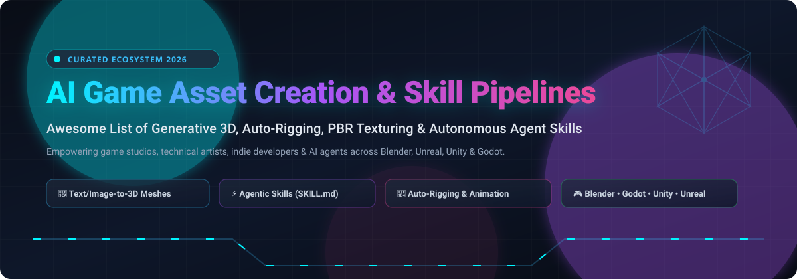

  

# 🎮 Awesome AI Game Asset Creation & Skill Pipelines 🚀

**The comprehensive, community-curated directory of generative 3D meshes, agentic skill pipelines (`SKILL.md`), auto-rigging, PBR material synthesis, and automated game-engine integrations for Blender, Godot, Unreal Engine, and Unity.**

[Explore SaaS Platforms](#-saashosted-platforms) • [Explore Open-Source Projects](#-open-source-github-projects) • [Sector Overview](#-sector-overview--market-dynamics) • [Contributing](#-how-to-contribute) • [Support](#-support)

---

## 📑 Table of Contents

- [🌟 Sector Overview & Market Dynamics](#-sector-overview--market-dynamics)
- [☁️ SaaS/Hosted Platforms](#-saashosted-platforms)
- [💻 Open-Source GitHub Projects](#-open-source-github-projects)
- [📈 Star History](#-star-history)
- [🤝 How to Contribute](#-how-to-contribute)
- [💖 Support](#-support)
- [📜 License & Disclaimer](#-disclaimer)

---

## 🌟 Sector Overview & Market Dynamics

> The global generative AI in gaming and 3D digital asset creation market is estimated at **$2.0B to $3.2B**, expanding rapidly at an annualized compound growth rate (CAGR) of **25% to 30%** through 2030 as game studios replace labor-intensive manual asset bottlenecks with procedural and neural generation workflows.
>
> **Market Dynamics:** The ecosystem exhibits a distinct **two-tier market structure**: it is **highly concentrated at the foundation infrastructure layer**—dominated by well-capitalized frontier model labs and hyperscalers (e.g., Luma AI, Tencent, VAST/Tripo, and tech giants) capable of absorbing massive GPU training overheads—while remaining **moderately to highly fragmented at the tooling and downstream application layer**, where dozens of specialized SaaS platforms, indie tools, and open-source MCP agent skills compete for workflow integration across Blender, Unreal Engine, Unity, and Godot.

---

## ☁️ SaaS/Hosted Platforms

The table below ranks premier SaaS game asset platforms sorted in descending order by **Company Scale (Valuation / Total Funding / Estimated Revenue)**.

| Platform | Company Scale (Valuation / Funding) | Starting Price (Paid Tier) | Free Tier Limits / Free Trial | Core Capabilities & Engine Bridges |
| :--- | :--- | :--- | :--- | :--- |
| **[Luma AI](https://lumalabs.ai)** | **$4.0B+ Valuation** ($1.06B+ raised; ~$80M ARR) | **$25.00/mo** ($30/mo month-to-month, Plus tier with ~10K credits) | **Free trial only** (limited non-commercial trial generations with watermarking/rate throttling; no permanent free quota) | High-speed Genie text/image-to-3D asset generation, quad retopology, PBR materials, and GLB/FBX/OBJ/USDZ exports. |
| **[Meshy.ai](https://meshy.ai)** | **$1.5B Valuation** (~$400M Series B; multi-million ARR) | **$20.00/mo** (Pro tier; $10/mo promotional introductory period) | **100 credits/mo** refreshed monthly; capped at **10 downloads/mo** of untextured Meshy-6 Lite models under CC BY 4.0 | End-to-end 3D mesh synthesis, AI PBR texture baking, automatic quad remeshing, skeletal auto-rigging, and native Blender/Unity/Unreal/Godot plugins. |
| **[Tripo3D](https://tripo3d.ai)** | **$1.0B–$1.5B Valuation** ($446M+ raised across Series B/B+) | **$20.00/mo** (Pro tier; discounted to $13.30/mo on annual billing) | **200 credits/mo** (~13 basic generations/mo); single task concurrency; public non-commercial CC attribution models | Sub-second generative 3D meshes, multi-view reconstruction, Smart Mesh topology optimization, auto-rigging, and clean UV unwrapping. |
| **[Common Sense Machines](https://csm.ai)** | **$15M+ Acquisition by Google** ($10M+ venture funding) | **$20.00/mo** (Indie/Pro Cube tier for commercial usage) | **10 free one-time credits** upon registration; outputs restricted to public Creative Commons (CC BY 4.0) licensing | Multimodal spatial AI engine converting 2D concept images, text prompts, and video turnarounds into 3D meshes and interactive scene environments. |
| **[Spline AI](https://spline.design)** | **$75M Valuation** ($32M cumulative funding; $10M Series A) | **$12.00/seat/mo** (Hobby plan billed annually, or $15/seat monthly) | **Permanent free editor plan**, but includes **0 recurring monthly AI credits**; web exports carry Spline branding watermark | Collaborative real-time 3D web editor featuring integrated generative AI mesh styling, prompt-driven texture editing, and WebGL/game UI export. |
| **[Kaedim](https://kaedim3d.com)** | **~$60M Valuation** ($15.2M total funding; $15M Series A by a16z) | **$400.00/mo** (Indie plan, 20 generation credits/mo; $1,200/mo Studio) | **7-day paid evaluation trial** ($50–$100 for 5 trial credits); no permanent free tier | Production-grade 2D concept art to game-ready 3D pipeline combining AI geometry synthesis with human-in-the-loop technical artist QA and clean quad UVs. |
| **[Scenario](https://scenario.com)** | **~$25M Valuation** ($10.9M venture funding; $6M Seed) | **$15.00/mo** (Starter plan; scalable up to Pro/Enterprise tiers) | **50 daily free credits** (refreshed every 24 hours); strictly limited to personal testing and non-commercial evaluation | Studio-grade generative AI platform enabling game developers to fine-tune bespoke, style-consistent models for 2D sprites, UI textures, and 3D concept pipelines. |
| **[Sloyd.ai](https://sloyd.ai)** | **~$12M–$15M Est. Valuation** (€3.0M / ~$3.3M Seed led by a16z Games) | **$15.00/mo** (Plus plan; $12.50/mo on annual billing) | **1 free AI generation per day**; unlimited parametric template tweaks; non-commercial personal-use license only | Parametric and generative real-time 3D asset modeler tailored for indie game developers generating clean, low-poly props, weapons, and architectural assets. |
| **[Hyper3D Rodin](https://hyper3d.ai)** | **~$15M+ Est. Scale** (Tens of millions USD Series A backed by ByteDance) | **$30.00/mo** (Creator plan; $24/mo on annual billing at $280/yr) | **Pay-by-result free preview**; up to 10 private asset slots; public gallery generations without high-res texture/smart low-poly passes | High-fidelity generative 3D platform featuring multi-view geometry synthesis, OmniCraft mesh editing, and production quad/triangle exports. |
| **[3DFY.ai](https://3dfy.ai)** | **~$6M–$8M Est. Scale** (~$1.5M Seed led by Maverick Ventures) | **$15.00/mo** (Starter subscription; or pay-as-you-go from $5/model) | **10 free generation credits** provided upon initial sign-up; non-commercial evaluation terms | Automated text-to-3D and image-to-3D model synthesis tailored for high-volume catalog generation, props, and simulations. |
| **[Masterpiece X](https://masterpiecex.com)** | **~$3M–$5M Est. Scale** (~$500K disclosed institutional funding) | **$9.99/mo** (Credit refill packs & creator subscriptions from $9.99/mo) | **250 free starter credits** awarded upon signup; browser-based preview and community remixing | Generative 3D creation and remixing studio featuring text-to-3D mesh generation, auto-rigging, and animation in-browser and VR. |

---

## 💻 Open-Source GitHub Projects

Explore sovereign, local-first, and credit-free game asset creation repositories. Ranked in descending order by **GitHub Stars_Count**.

| Repository | GitHub_Stars | License | Primary Focus & Capabilities |
| :--- | :--- | :--- | :--- |
| **[godotengine/godot](https://github.com/godotengine/godot)** |  | `MIT` | Premier open-source 2D/3D game engine featuring native `.glb`/`.blend` auto-import pipelines, GridMap procedural building, and AI coding agent MCP bridges. |
| **[ahujasid/mcp-for-blender](https://github.com/ahujasid/mcp-for-blender)** |  | `MIT` | Live Model Context Protocol (MCP) server enabling Claude, Cursor, and AI agents to execute Blender Python commands for modeling, retopology, and game asset exports. |
| **[graphdeco-inria/gaussian-splatting](https://github.com/graphdeco-inria/gaussian-splatting)** |  | `Reference` | Original 3D Gaussian Splatting codebase enabling real-time radiance field rendering, photogrammetry scanning, and environment capture for game worlds. |
| **[blender/blender](https://github.com/blender/blender)** |  | `GPL-2.0+` | Flagship open-source 3D DCC suite with Geometry Nodes procedural asset synthesis, Cycles PBR texture baking, Rigify character rigging, and headless CI export. |
| **[Tencent-Hunyuan/Hunyuan3D-2](https://github.com/Tencent-Hunyuan/Hunyuan3D-2)** |  | `Tencent Free` | High-resolution generative 3D asset suite combining flow-based shape diffusion (`Hunyuan3D-DiT`) and PBR texture synthesis (`Hunyuan3D-Paint`) with native Blender add-on. |
| **[microsoft/TRELLIS](https://github.com/microsoft/TRELLIS)** |  | `MIT` | Structured 3D Latents (SLAT) foundation model synthesizing high-fidelity textured game meshes, 3D Gaussians, and radiance fields from text/images. |
| **[openai/shap-e](https://github.com/openai/shap-e)** |  | `MIT` | OpenAI's conditional 3D generative model generating implicit functions, textured meshes, and neural radiance fields from text or single image inputs. |
| **[nerfstudio-project/nerfstudio](https://github.com/nerfstudio-project/nerfstudio)** |  | `Apache-2.0` | Modular framework for neural radiance field (NeRF) development and 3D Gaussian Splatting pipeline capture for game environment backgrounds. |
| **[ashawkey/stable-dreamfusion](https://github.com/ashawkey/stable-dreamfusion)** |  | `Apache-2.0` | PyTorch implementation of text-to-3D DreamFusion using 2D Stable Diffusion Score Distillation Sampling (SDS) to generate textured meshes. |
| **[zeux/meshoptimizer](https://github.com/zeux/meshoptimizer)** |  | `MIT` | Mesh optimization library for game developers: automated LOD simplification, vertex cache optimization, shadow casters, and Draco/KTX2 compression. |
| **[LibreSprite/LibreSprite](https://github.com/LibreSprite/LibreSprite)** |  | `GPL-2.0` | FOSS 2D pixel art, sprite sheet, and animation editor for indie game character, tilemap, and retro asset creation. |
| **[VAST-AI-Research/TripoSR](https://github.com/VAST-AI-Research/TripoSR)** |  | `MIT` | Ultra-fast feed-forward 3D reconstruction model by VAST & Stability AI generating textured 3D meshes in under 0.5s on a single GPU. |
| **[threestudio-project/threestudio](https://github.com/threestudio-project/threestudio)** |  | `Apache-2.0` | Unified PyTorch framework for 3D content creation from text prompts or single images via Score Distillation Sampling (SDS) and multi-view diffusion. |
| **[RodZill4/material-maker](https://github.com/RodZill4/material-maker)** |  | `MIT` | Procedural PBR material authoring and 3D texture painting tool based on the Godot engine with 200+ nodes and one-click Unity/Unreal/Blender exports. |
| **[JannisX11/blockbench](https://github.com/JannisX11/blockbench)** |  | `GPL-3.0` | Low-poly 3D modeling, UV pixel-art texturing, and skeletal animation tool widely used for Minecraft, Godot, and stylized indie games. |
| **[TencentARC/InstantMesh](https://github.com/TencentARC/InstantMesh)** |  | `Apache-2.0` | Efficient feed-forward framework turning a single 2D concept image into a textured 3D game mesh in 10 seconds via multi-view diffusion and LRM. |
| **[arjun988/blender-skills](https://github.com/arjun988/blender-skills)** |  | `MIT` | Extensive suite of 90+ specialized agent skills (`SKILL.md`) for AI assistants to control Blender for blockouts, UV unwrapping, baking, and game export. |
| **[MrForExample/ComfyUI-3D-Pack](https://github.com/MrForExample/ComfyUI-3D-Pack)** |  | `MIT` | Visual node suite integrating `TRELLIS`, `Hunyuan3D`, `TripoSR`, and Gaussian Splatting into reproducible ComfyUI game asset pipelines. |
| **[scenario-labs/skills](https://github.com/scenario-labs/skills)** |  | `Apache-2.0` | Official suite of modular AI agent skills (`SKILL.md`) for game asset generation, style-consistent turnarounds, and automated production pipelines. |
| **[Mesh2Motion/mesh2motion-app](https://github.com/Mesh2Motion/mesh2motion-app)** |  | `MIT` | Open-source Mixamo alternative for automated character rigging, weight painting, and 40+ retargetable animations for biped and creature meshes. |
| **[wgsxm/PartCrafter](https://github.com/wgsxm/PartCrafter)** |  | `Apache-2.0` | Structured 3D generative model producing part-decomposed, modular 3D game assets from single images rather than fused single-shell geometry. |
| **[VAST-AI-Research/UniRig](https://github.com/VAST-AI-Research/UniRig)** |  | `MIT` | Unified auto-rigging framework using autoregressive transformer models to predict valid skeletal joint hierarchies and skinning weights. |
| **[donmccurdy/glTF-Transform](https://github.com/donmccurdy/glTF-Transform)** |  | `MIT` | Fast Node.js / CLI toolkit for processing 3D glTF/GLB models: deduplicating draw calls, resizing textures, and applying Draco/Meshopt compression. |
| **[Bingeljell/image-to-3dlab](https://github.com/Bingeljell/image-to-3dlab)** |  | `Apache-2.0` | Local-first pipeline ("AssetFurnace") for Apple Silicon and NVIDIA GPUs converting image prompts into textured, auto-rigged `.glb` game assets. |
| **[Supra-3D/SUPRA-Tex](https://github.com/Supra-3D/SUPRA-Tex)** |  | `Apache-2.0` | Generative 3D texture synthesis framework utilizing MLLM PBR prediction and flow transformers to generate relightable 4K `.glb` game assets. |
| **[blendi-remade/prompt2rig](https://github.com/blendi-remade/prompt2rig)** |  | `MIT` | Open-source prompt-to-3D-animation pipeline extracting natural skeletal and finger kinematics directly onto rigged 3D game characters. |
| **[3DTopia/MaterialAnything](https://github.com/3DTopia/MaterialAnything)** |  | `Apache-2.0` | CVPR 2025 Highlight PBR material synthesis model generating physically relightable albedo, roughness, and metallic texture maps for untextured 3D meshes. |
| **[majidmanzarpour/blender-game-skills](https://github.com/majidmanzarpour/blender-game-skills)** |  | `MIT` | Claude Code agent skill pipeline for Blender converting 2D character turnarounds into rigged, reference-measured, game-ready GLB/FBX assets. |
| **[Jpalmer95/game-3d-asset-skills](https://github.com/Jpalmer95/game-3d-asset-skills)** |  | `MIT` | Agentic skill suite automating end-to-end 3D game prop and character pipelines via local `TRELLIS`, `Hunyuan3D`, retopology, and Blender MCP execution. |

---

## 📈 Star History

---

## 🤝 How to Contribute

Contributions are warmly welcome! Help expand the directory by following these guidelines:

1. **Fork the Repository** and create a feature branch (`git checkout -b feature/new-asset-tool`).
2. **Review Inclusion Standards**:
   - SaaS platforms must specify verifiable starting pricing tiers and free tier/trial limits.
   - Open-source projects must be actively maintained with public code repositories.
   - Clearly document game engine integrations (`Blender`, `Godot`, `Unreal Engine`, `Unity`) and file exports (`GLB`, `FBX`, `USDZ`).
3. **Commit Your Changes** (`git commit -m "feat: add AwesomeTool entry"`) and push your branch.
4. **Open a Pull Request** describing your additions and engine compatibility.

---

## 💖 Support

If this curated list helps accelerate your game development workflow or AI asset research, please consider supporting the project:

- ⭐ **Star this repository** on GitHub to improve its discovery!
- 🍴 **Fork and contribute** your favorite agentic pipelines and tools.
- 📢 **Share** with fellow game developers, technical artists, and indie studios on Discord, Twitter/X, and Reddit.
- ☕ **Buy Me a Coffee**: Support ongoing maintenance and research via the [GitHub Sponsor Dashboard](https://github.com/sponsors/ishandutta2007).

---

## 📜 Disclaimer

*All product names, logos, and brands are property of their respective owners. Pricing tiers, credit allotments, and venture metrics reflect public market data as of late 2026 and may change over time.*
